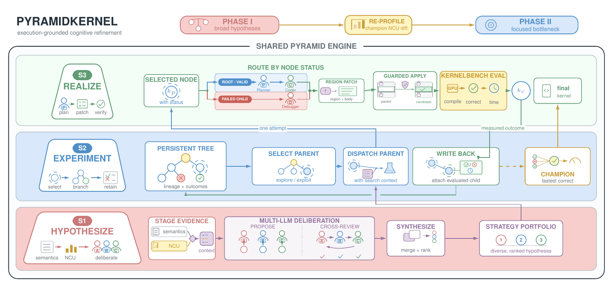

<h1 align="center">PyramidKernel</h1>

<p align="center">
  <strong>From Broad Hypotheses to Bottleneck-Focused Refinement<br>
  for LLM-Driven GPU Kernel Optimization</strong>
</p>

<p align="center">
  <a href="https://github.com/huskxu">Husk Xu</a> &nbsp;&middot;&nbsp;
  <a href="https://github.com/yijiaduan111">Yijia Duan</a> &nbsp;&middot;&nbsp;
  <a href="https://github.com/MqLeet">Qianli Ma</a> &nbsp;&middot;&nbsp;
  <a href="https://zhipengzhang.cn/">Zhipeng Zhang</a>
</p>

<p align="center">
  
  
  
  <a href="LICENSE"></a>
</p>

<p align="center">
  <a href="#overview">Overview</a> &nbsp;&middot;&nbsp;
  <a href="#results">Results</a> &nbsp;&middot;&nbsp;
  <a href="#installation">Installation</a> &nbsp;&middot;&nbsp;
  <a href="#quick-start">Quick Start</a> &nbsp;&middot;&nbsp;
  <a href="#reproducing-the-paper-results">Reproduction</a> &nbsp;&middot;&nbsp;
  <a href="#repository-structure">Structure</a>
</p>

## 🧭 Overview

PyramidKernel is a stage-structured multi-agent framework for LLM-driven GPU
kernel optimization. It combines broad, model-driven exploration with
execution-grounded convergence: the system first searches across diverse
implementation families, then re-profiles the fastest correct candidate and
focuses the remaining budget on its measured bottlenecks.

<p align="center">
  
</p>

<p align="center"><em>
PyramidKernel couples a two-phase broad-to-focused search with three shared
stages: S1 Hypothesize, S2 Experiment, and S3 Realize.
</em></p>

## 📊 Results

Under a budget of 10 candidates per task, PyramidKernel was evaluated on all
250 KernelBench tasks. The repository includes cleaned aggregate tables in
[results/paper](results/paper); raw prompts, credentials, and machine-specific
run archives are intentionally excluded.

| Scope | Tasks | Success@10 | Fast1@10 | Geomean speedup |
|:--|--:|--:|--:|--:|
| **Overall** | **250** | **93.2%** | **84.0%** | **1.40x** |
| Level 1 | 100 | 94.0% | 85.0% | 1.36x |
| Level 2 | 100 | 99.0% | 95.0% | 1.57x |
| Level 3 | 50 | 80.0% | 60.0% | 1.15x |

`Success@10` is the fraction of tasks with at least one correct generated
candidate. `Fast1@10` additionally requires a correct candidate faster than the
PyTorch eager reference. Geometric-mean speedup is computed over solved tasks.
GPU timings depend on hardware and software versions; see
[the reproducibility guide](docs/reproducibility.md) before comparing runs.

## ⚙️ Installation

Full KernelBench experiments require Linux, an NVIDIA GPU, Python 3.10 or
newer, a CUDA-compatible PyTorch build, and `nvcc`. Nsight Compute (`ncu`) is
only needed for optional diagnostics.

```bash
git submodule update --init --recursive

python -m venv .venv
source .venv/bin/activate
python -m pip install --upgrade pip
python -m pip install -e ".[dev]"
```

For CUDA experiments, first install the PyTorch build matching the host driver
and CUDA toolkit, then install the relevant extras:

```bash
python -m pip install -e ".[cuda,dev]"
```

Conda users can create the provided environment directly:

```bash
conda env create -f environment.yml
conda activate pyramidkernel
```

Copy `.env.example` to `.env` and configure only the model providers you plan
to use. Never commit `.env`, API responses, model weights, or generated run
directories.

## 🚀 Quick Start

The provider-free demo checks the complete planning, realization, evaluation,
and persistence path without requiring a GPU or API key:

```bash
python -m pytest -q

pyramidkernel run-demo \
  --task square_list \
  --experiment quick \
  --output-dir runs/demo_square_list
```

Run one CUDA KernelBench task after configuring a provider:

```bash
bash scripts/run_single.sh \
  --experiment main \
  --level 1 \
  --problem-id 25 \
  --backend cuda \
  --output-dir runs/l1_p25
```

A completed task writes `run.json` and `best_code.py`. Always use a fresh
output directory so artifacts from separate runs cannot be mixed.

## 🔬 Reproducing the Paper Results

The `pyramidkernel_paper` profile selects the complete 250-task manifest,
10-attempt budget, model routing, multi-model deliberation, evaluator
isolation, and measurement protocol:

```bash
bash scripts/run_batch.sh \
  --experiment pyramidkernel_paper \
  --output-dir runs/pyramidkernel_paper
```

The reported main results used an NVIDIA RTX 4090; cross-system experiments
used an NVIDIA A100 80GB. Record the repository and KernelBench commits, model
identifiers, GPU, driver, CUDA, PyTorch, and timing settings for every
reproduction. The complete checklist and metric definitions are in
[docs/reproducibility.md](docs/reproducibility.md).

## 🧩 Configuration

Three top-level experiment profiles are included:

| Profile | Purpose | Provider | Task set |
|:--|:--|:--|:--|
| `quick` | Provider-free wiring and smoke checks | Mock | Small smoke set |
| `main` | Regular full experiments | Configurable | Configured manifest |
| `pyramidkernel_paper` | Paper protocol | Role-routed models | All 250 tasks |

Profiles compose task, search, evaluator, measurement, model-routing, and
runtime YAML files under `configs/`. See [docs/03_config_guide.md](docs/03_config_guide.md)
for the configuration model and [docs/01_quickstart.md](docs/01_quickstart.md)
for common commands.

## 🗂️ Repository Structure

```text
PyramidKernel/
├── pyramidkernel/
│   ├── agents/              # Planning, coding, and debugging roles
│   ├── core/                # Workflow, candidate tree, guards, and loader
│   ├── deliberation/        # Multi-model proposal and cross-review
│   ├── diagnostics/         # Nsight Compute profiling and summaries
│   ├── evaluation/          # KernelBench evaluation and isolation
│   ├── experiment/          # Batch execution and result aggregation
│   ├── feedback/            # Search feedback state
│   ├── phases/              # Phase transition schemas and rendering
│   ├── providers/           # API-compatible and local model backends
│   ├── semantics/           # Program and tensor fact extraction
│   ├── cli.py               # Public command-line interface
│   ├── config.py            # Layered profile resolution
│   └── models.py            # Shared runtime data models
├── configs/
│   ├── experiments/         # Top-level quick, main, and paper profiles
│   ├── models/              # Provider and role-routing profiles
│   ├── evaluation/          # Evaluator and measurement settings
│   ├── runtime/             # Benchmark path and device settings
│   ├── search/              # Search budgets and policies
│   └── tasks/               # KernelBench manifests
├── scripts/                 # Launch, validation, and reporting helpers
├── docs/                    # Usage and reproducibility guides
├── results/paper/           # Cleaned aggregate paper results
├── tests/                   # Unit, integration, and CLI smoke tests
└── KernelBench/             # Pinned upstream benchmark submodule
```

## 🛠️ Development and Security

```bash
python -m ruff format --check pyramidkernel tests
python -m ruff check pyramidkernel tests
python -m pytest -q
bash -n scripts/*.sh
```

Generated Python and CUDA programs are untrusted code. Use an isolated,
disposable environment without production credentials or sensitive data.
Read [SECURITY.md](SECURITY.md) before evaluating generated kernels and
[CONTRIBUTING.md](CONTRIBUTING.md) before opening a pull request.

## 📖 Citation

If PyramidKernel is useful in your research, please cite:

```bibtex
@misc{xu2027pyramidkernel,
  title  = {PyramidKernel: From Broad Hypotheses to Bottleneck-Focused
            Refinement for LLM-Driven GPU Kernel Optimization},
  author = {Xu, Husk and Duan, Yijia and Ma, Qianli and Zhang, Zhipeng},
  year   = {2027}
}
```

Machine-readable software citation metadata is available in
[CITATION.cff](CITATION.cff).

## 🙏 Acknowledgements

PyramidKernel builds on [KernelBench](https://github.com/ScalingIntelligence/KernelBench)
and the PyTorch, Triton, TileLang, and NVIDIA CUDA ecosystems. See
[THIRD_PARTY_NOTICES.md](THIRD_PARTY_NOTICES.md) for third-party licensing
details.

## 📄 License

The original PyramidKernel source code is released under the
[Apache License 2.0](LICENSE).

## ⭐ Star History

<p align="center">
  <a href="https://www.star-history.com/#yijiaduan111/PyramidKernel&amp;Date">
    
  </a>
</p>
